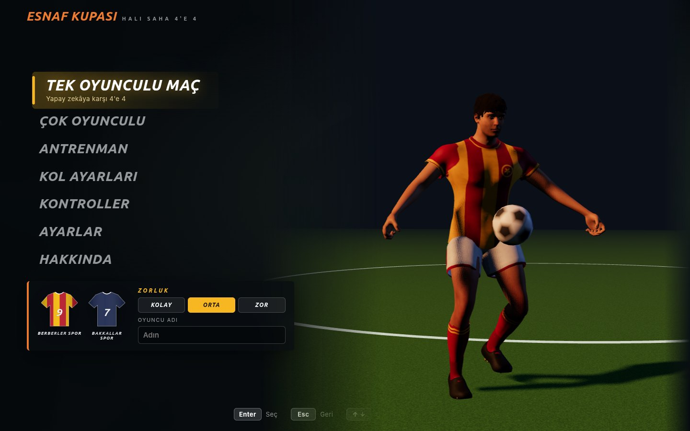
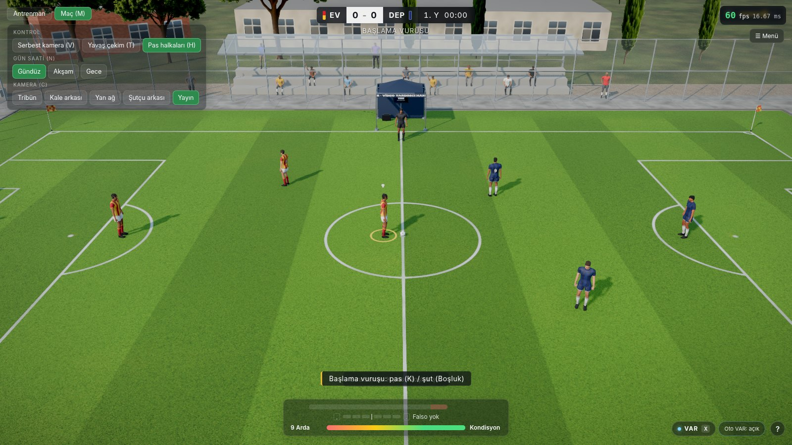
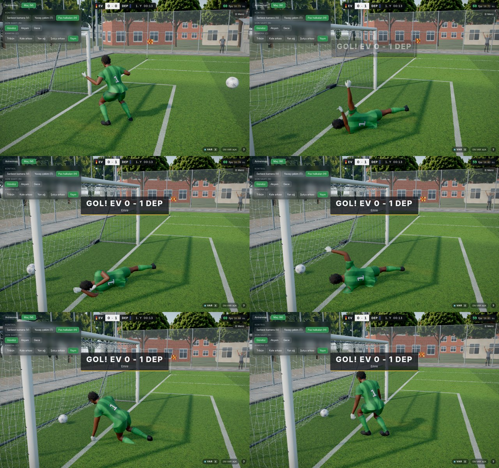
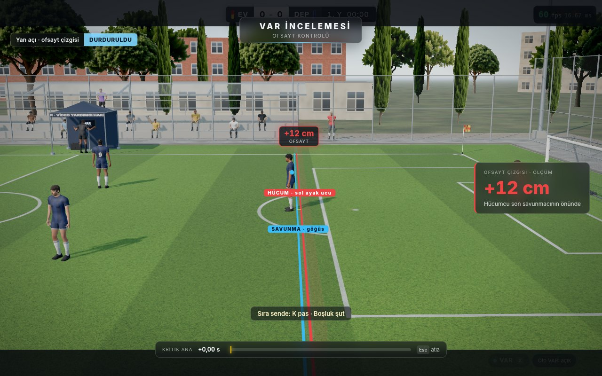

# Esnaf Kupası · Halı Saha 4'e 4 (kaynak)

Three.js, React 19, TypeScript ve @react-three/fiber ile yazılmış, Blender (MPFB2) ile üretilmiş karakterlere sahip gerçekçi 4'e 4 halı saha futbol oyunu. Oynanabilir sürüm: https://egerberkuslu.github.io/footballer-4v4-play/ (derlenmiş site ayrı, herkese açık depoda; bu kaynak depo özel).






Tüm ekran görüntüleri `docs/screenshots/` altındadır (yükleme ekranı, menü, maç, gece, VAR, kaleci, falso, kol ayarları).

## Yapı

| Klasör | İçerik |
|---|---|
| `viewer/` | Vite + React + R3F oyunu. `src/sim` fizik (top, ağ, kaleci dalışı), `src/control` kontrol ve kol, `src/ai` yapay zekâ, `src/rules` hakem ve kurallar, `src/var` VAR, `src/anim` ve `src/characters` karakterler, `src/mp` çok oyunculu, `src/ui` yükleme ve menü, `src/cloth` GPU forma kumaşı, `src/env` ve `src/grass` saha ve çevre |
| `human/` | Blender / MPFB2 karakter ve forma hattı (`run_variant.sh`, `s6_web.py`, `hair_cards.py`, `kit_make.py`) |
| `tools/` | `publish-pages.sh` (derle ve GitHub Pages'e yayınla), `emergency-save.sh` |
| `handoff/`, `CONTRACT.md` | ajanlar arası sözleşme ve devir notları |
| `viewer/qa/SABAH-RAPORU.md` | kalite raporu ve açık sorunlar |

## Çalıştırma

```bash
cd viewer
npm install
npm run dev        # http://localhost:5173
npm run build      # tsc -b + vite build
```

Yayın: `bash tools/publish-pages.sh` (kaynağı özel depoya kaydeder, temiz derleme alır, herkese açık site deposuna iter).

## Testler

`viewer/scripts/` altında: `rules-test.mjs` (kural motoru), `sim-test.mjs` (fizik), `ctl-gamepad-unit.mjs` (kol eşlemesi), `qa-round.sh` (derleme, Firefox, maç ve senaryo turu), `mp-test.mjs` (çok oyunculu), `koord-live.mjs` (canlı site). Tarayıcı testleri `scripts/run-browser.sh` ile, gerçek GPU için `--use-angle=gl`.

## Dürüst notlar

Gerçek bir PS4/DualSense kolu ile denenmedi (sahte kol testleri var). Çok oyunculu bağlantı halka açık PeerJS sinyal sunucusuna dayanır, TURN yoktur. Mobil görünüm sınanmadı.
