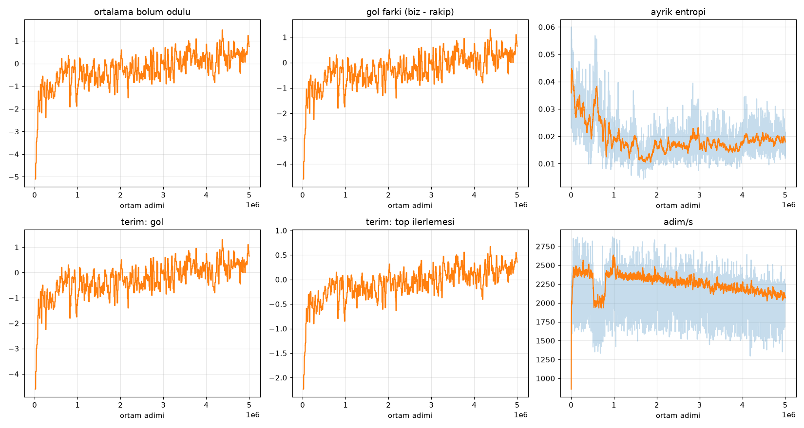

# M1 sanity kosusu: MAPPO + deepsets, 4v4 vs heuristic:kolay

Komut: `train.py --encoder deepsets --opponent heuristic:kolay --steps 5000000 --envs 10 --seed 1` (tohum 1, W=10 Node isci, cuda, torch 2.13.0+cu130, OBS_VERSION 1). Kayit: `rl/runs/m1a/` (config.json, log.csv, ckpt.pt, curve.png, eval_*.json).

Sure 38 dk, 5000960 ortam adimi, ortalama 2222 adim/s uctan uca (hedef >= 4000 TUTMADI: Python lockstep + GPU cikarimi). GPU kullanimi (nvidia-smi ornekleri, egitim sirasinda): ortalama 18%, bellek 749 MB.

## Ogrenme egrisi (egitim bolumleri, stokastik politika)

| adim | ort. bolum odulu | gol farki (biz-rakip) |
|---|---|---|
| 0.0-0.5 M | -1.55 | -1.40 |
| 0.5-1.0 M | -0.56 | -0.53 |
| 1.0-2.0 M | -0.46 | -0.46 |
| 2.0-3.0 M | -0.26 | -0.27 |
| 3.0-4.0 M | +0.15 | +0.11 |
| 4.0-5.1 M | +0.30 | +0.24 |

Odul terimleri (bolum ortalamasi, ajan basina): goal -1.398 -> +0.239, ball_approach -1.029 -> -1.494, ball_progress -0.655 -> +0.180, pass_ok +0.097 -> +0.001, steal +1.424 -> +1.494, foul -0.229 -> -0.126, card -0.290 -> -0.009 (ilk 0.5 M adim -> son 1 M adim).

## Degerlendirme (100 mac, farkli tohum, deterministik politika, bootstrap %95 GA)
| rakip / politika | mac | gol (biz) | gol (rakip) | gol farki [GA] | G/B/M |
|---|---|---|---|---|---|
| heuristic:kolay / **MAPPO deepsets** | 100 | 2.84 | 3.93 | -1.09 [-1.62, -0.57] | 26/18/56 |
| heuristic:kolay / rastgele | 100 | 0.65 | 4.27 | -3.62 [-3.99, -3.27] | 1/5/94 |
| heuristic:kolay / her zaman bosta | 100 | 0.00 | 0.26 | -0.26 [-0.39, -0.15] | 0/82/18 |
| heuristic:orta / **MAPPO deepsets** | 100 | 3.17 | 3.93 | -0.76 [-1.13, -0.41] | 21/26/53 |
| heuristic:orta / rastgele | 100 | 0.61 | 5.12 | -4.51 [-4.86, -4.15] | 0/0/100 |
| heuristic:orta / her zaman bosta | 100 | 0.00 | 0.49 | -0.49 [-0.68, -0.33] | 0/71/29 |
| heuristic:zor / **MAPPO deepsets** | 100 | 2.58 | 4.83 | -2.25 [-2.60, -1.90] | 5/12/83 |
| heuristic:zor / rastgele | 100 | 0.43 | 5.84 | -5.41 [-5.77, -5.05] | 0/0/100 |
| heuristic:zor / her zaman bosta | 100 | 0.00 | 0.87 | -0.87 [-1.17, -0.59] | 0/62/38 |

## Yorum (dürüst)
- Ogrenme VAR: egitim gol farki ve bolum odulu yukseliyor, deterministik degerlendirmede rastgele tabana gore buyuk fark (kolay: -3.6 -> -1.1) ve atilan gol 0.65 -> 2.8.
- Ama 5 M adimda el yazmasi `kolay`i YENEMIYOR (G/B/M 26/18/56); hucum ogrenildi (gol atiyor), savunma/kaleci zayif (yenen gol 3.9). 'Her zaman bosta' tabani gol farkinda daha iyi (-0.26) cunku el yazmasi AI bos takima neredeyse gol atamiyor (0.26): yani goal_diff tek basina yeterli bir olcut degil, atilan ve yenen gol ayri okunmali.
- Olasi nedenler / sonraki adim (ara olcut: odul terimleri ve entropi): yenen gol cezasi sekillendirmesiz ve seyrek; ayrik entropi hizla ~0.02-0.05'e coktu (maske cogu zaman tek gecerli eylem birakiyor); sabit gamma 0.99 ve 1200 adimlik bolum; daha uzun egitim (>= 20 M), savunma icin top-kale araligi/konumlanma sekillendirmesi, kolay seviyeden orta seviyeye mufredat. Hicbiri bu kosuda denenmedi.
- Egitim (stokastik) son 1 M adim gol farki pozitif iken deterministik degerlendirmede negatif: deterministik eylem (ortalama + argmax) stokastikten daha kotu; `eval.py --stochastic` ile ayrica olculmedi (acik is).
- Tek tohum (1), tek koşu: guven araligi yalniz degerlendirme mac orneklemini yansitir, egitim tohumu varyansini degil (planin >= 5 tohum kurali henuz uygulanmadi).
